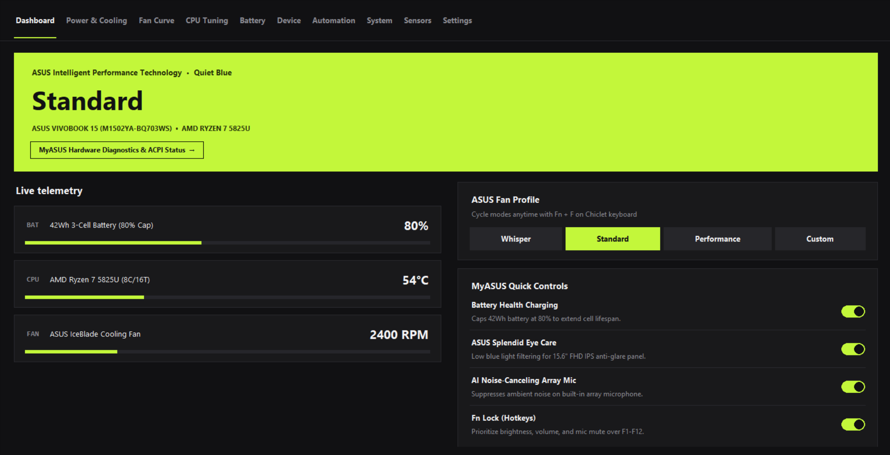
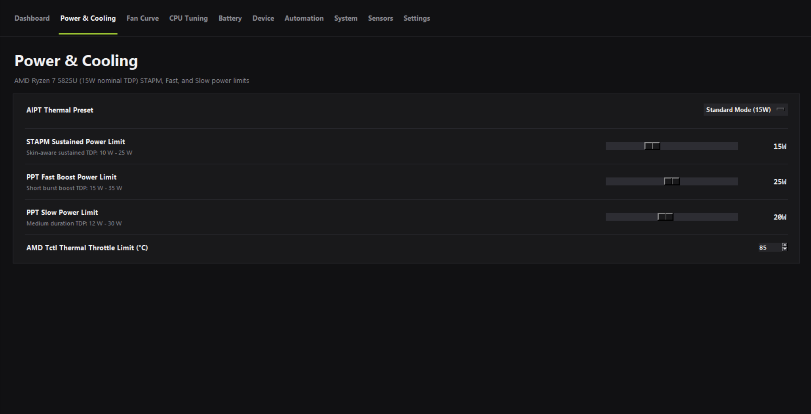
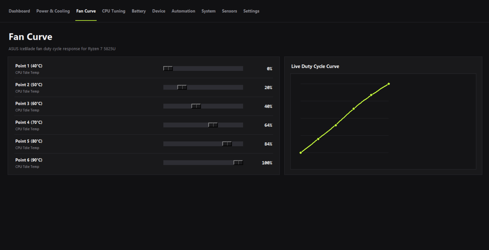
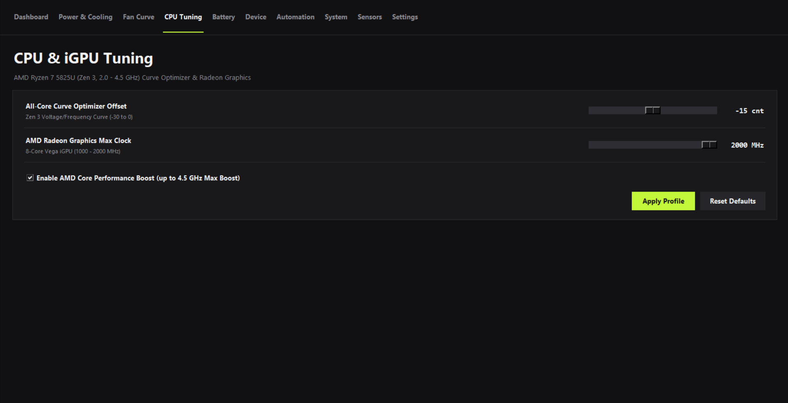
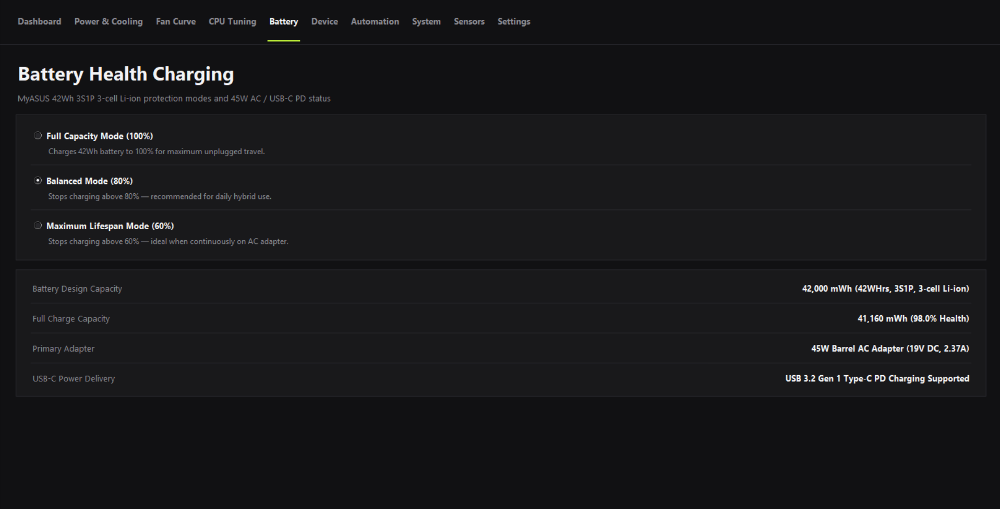
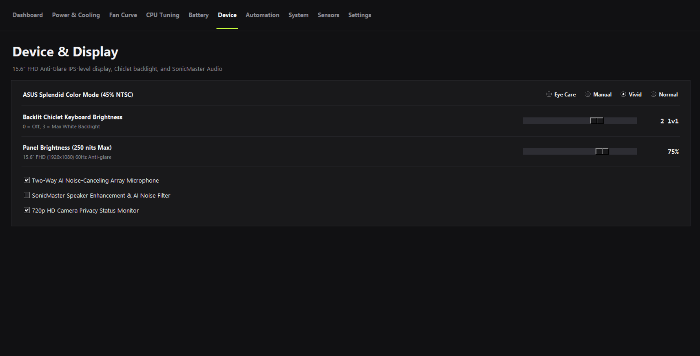
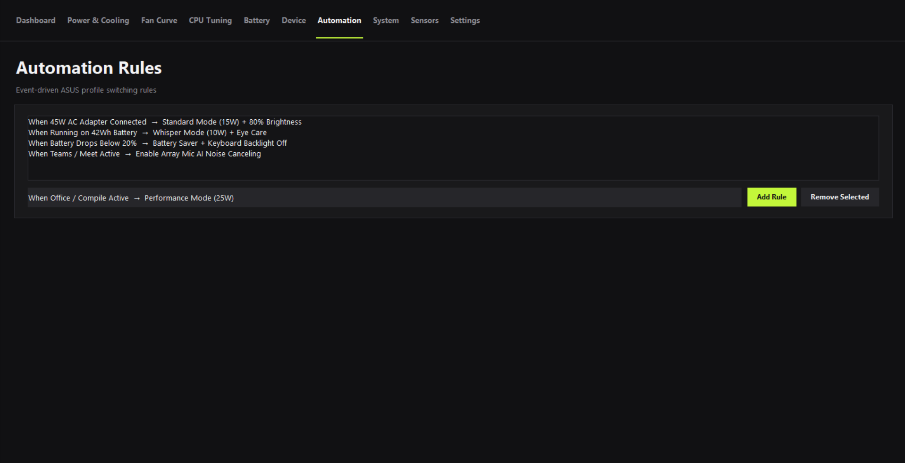
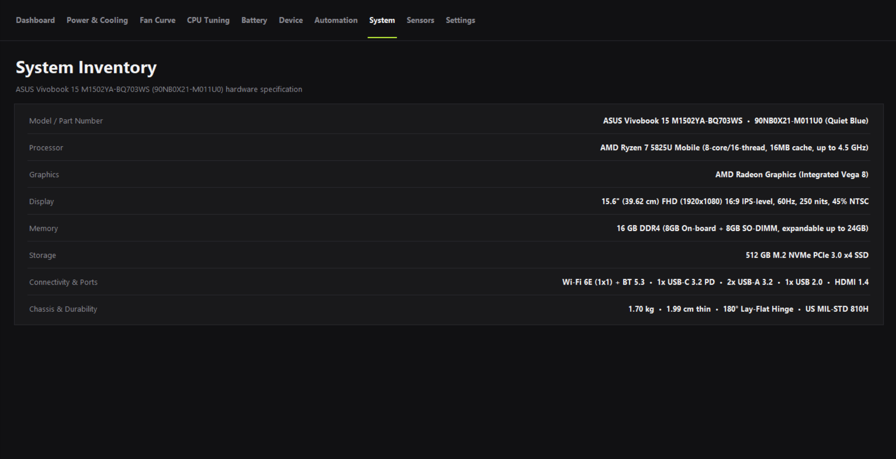
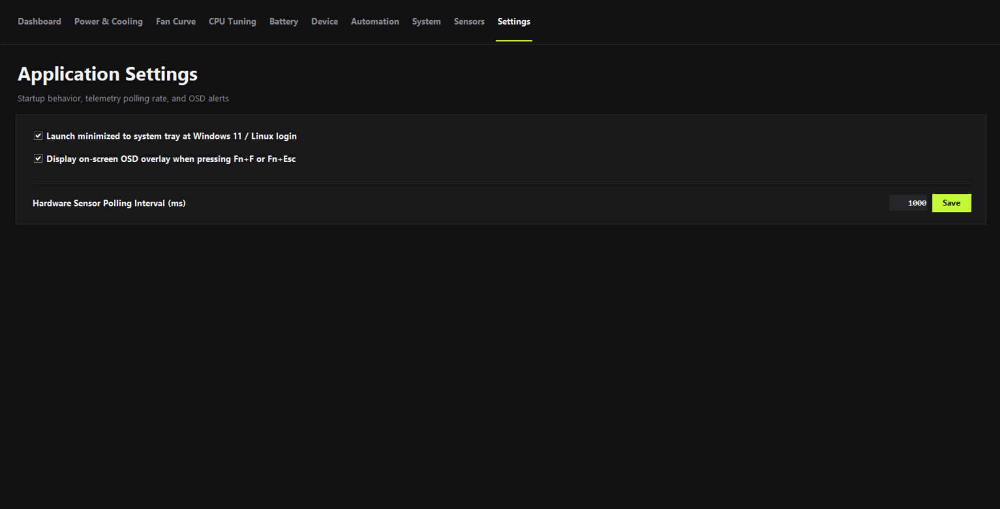

# ASUS_Control_Center

A lightweight, zero-dependency desktop control center built with pure Python `tkinter` for tuning and monitoring the ASUS Vivobook 15 (`M1502YA-BQ703WS`).


*Main dashboard showing live Ryzen 7 5825U telemetry, active AIPT fan profiles, and quick hardware toggles.*

## Why I Built This

Official OEM utilities like MyASUS are either bloated with background services, locked down on Linux, or missing granular controls for Ryzen STAPM power limits and custom fan curves. I wanted a single-file desktop frontend tailored specifically to the **ASUS Vivobook 15 (M1502YA-BQ703WS)** that starts instantly, uses almost zero RAM, and doesn't require installing a dozen third-party GUI packages.

## Key Features

- **One-Click AIPT Thermal Modes:** Switch between *Whisper (10W)*, *Standard (15W)*, *Performance (25W)*, and *Custom* profiles (mirroring `Fn + F` hotkey behavior).
- **Ryzen 7 5825U Power & SMU Tuning:** Adjust STAPM sustained, PPT Fast, and PPT Slow wattage limits, Tctl thermal throttle targets, Curve Optimizer offsets, and Radeon iGPU max clocks.
- **Interactive IceBlade Fan Curve:** Tune 6 temperature-to-duty-cycle points with a live `tk.Canvas` curve preview.
- **42Wh Battery Health Protection:** Cap charging at 60%, 80%, or 100% to prevent cell degradation when plugged into the 45W AC adapter or USB-C PD.
- **Display & Peripheral Controls:** Toggle ASUS Splendid color modes, Chiclet keyboard backlight levels, 250-nit panel brightness, and Two-Way AI Noise Canceling.
- **Rule-Based Automation:** Create event triggers to automatically swap profiles when plugging in AC power, dropping below 20% battery, or launching specific apps.
- **Zero External Dependencies:** Written strictly using Python's built-in `tkinter` standard library—no `pip install` required.

## Screenshots & Walkthrough

### 1. Dashboard & Live Telemetry

*Overview of the active AIPT power profile, 42Wh battery charge cap, Ryzen 7 5825U package temperature, IceBlade fan RPM, and MyASUS quick toggles.*

### 2. Power & Cooling + Fan Curve


*Granular sliders for STAPM/PPT power envelopes, thermal throttle limits, and the 6-point IceBlade fan duty cycle graph.*

### 3. CPU & iGPU Tuning

*Zen 3 All-Core Curve Optimizer offsets, Radeon Vega 8 iGPU clock limits, and Core Performance Boost toggles.*

### 4. Battery & Device Controls


*Charge threshold radio presets (60% / 80% / 100%), ASUS Splendid color gamut profiles, keyboard backlight levels, and array microphone filters.*

### 5. Automation, System Inventory, Sensors & Settings



*Custom event-driven profile rules, full M1502YA-BQ703WS hardware inventory, live thermal/voltage sensor readouts, and polling interval configuration.*

## Quick Start

Since the app relies exclusively on Python's standard library, setup takes less than a minute.

### Prerequisites
- Python 3.8+ with `tkinter` enabled (on Ubuntu/Debian, ensure `python3-tk` is installed).

### Installation & Running

```bash
# 1. Clone the repository
git clone [https://github.com/yourusername/ASUS_Control_Center.git](https://github.com/yourusername/ASUS_Control_Center.git)
cd ASUS_Control_Center

# 2. (Optional) Verify tkinter is available
python3 -m tkinter

# 3. Run the application
python3 frontend.py