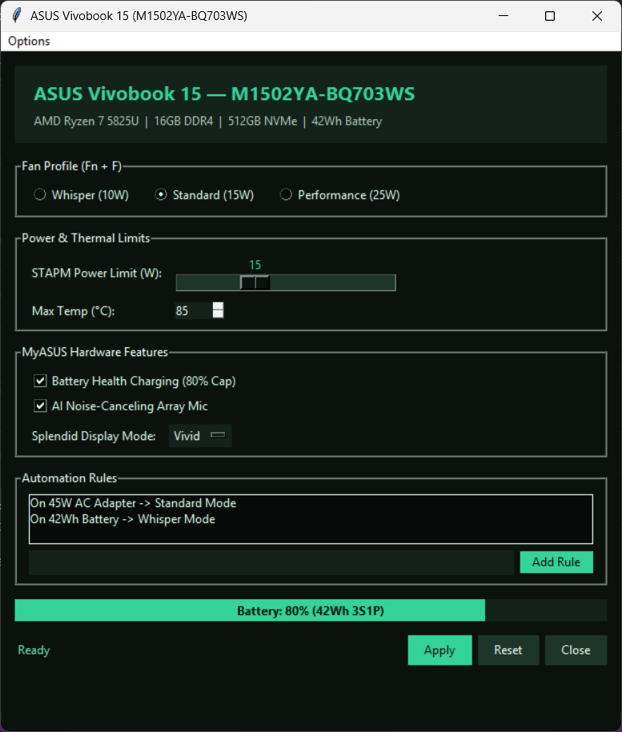

# ASUS Vivobook 15 Control Center

A simple desktop app built with Python and Tkinter to manage fan profiles, power limits, and MyASUS hardware settings for the **ASUS Vivobook 15 (M1502YA-BQ703WS)**. It brings quick controls like battery charge limits, display modes, and automation rules together in one lightweight window.



## How to Run

1. **Make sure Python 3 is installed** on your computer. You can download it from [python.org](https://www.python.org/downloads/) if you don't have it yet. *(No extra libraries are needed—it only uses Python's built-in `tkinter` module.)*
2. **Download or clone this repository** and open the project folder in your terminal or command prompt.
3. **Run the script** with:
   ```bash
   python frontend.py